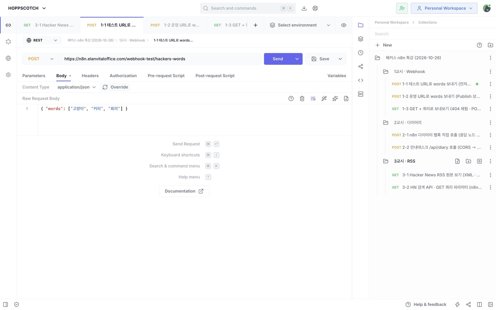
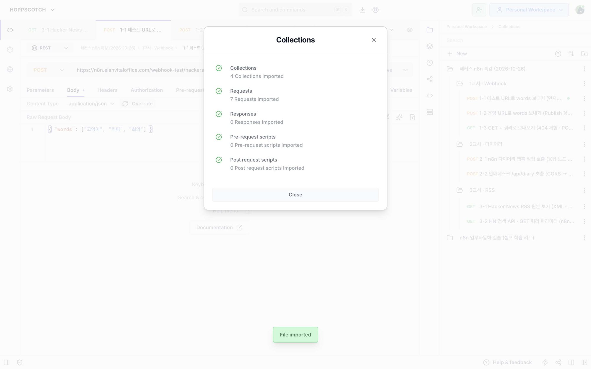
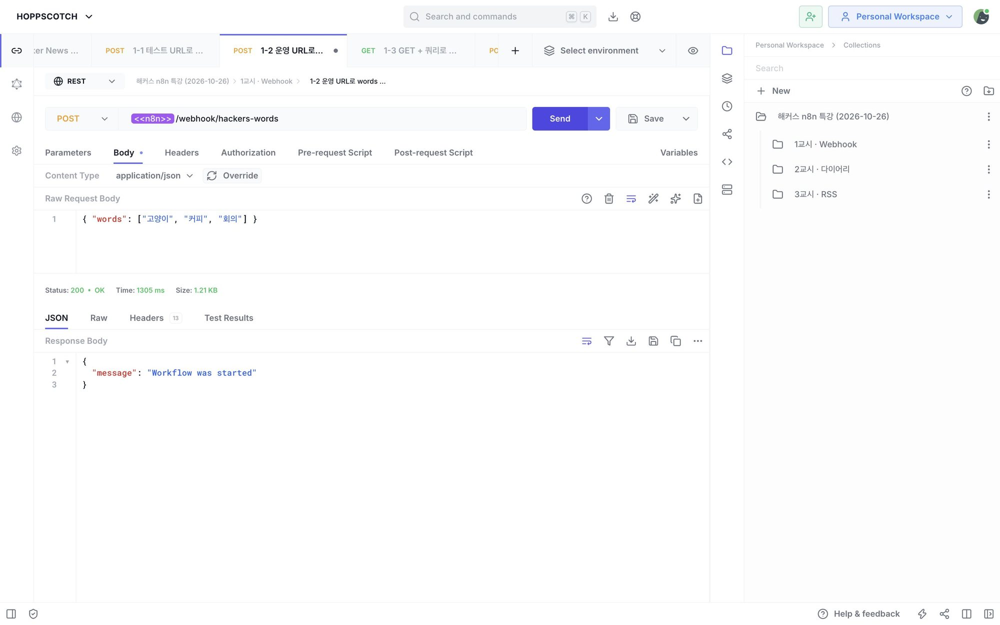
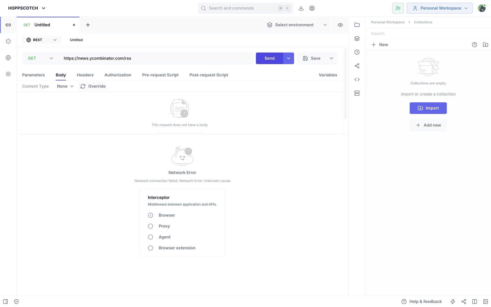
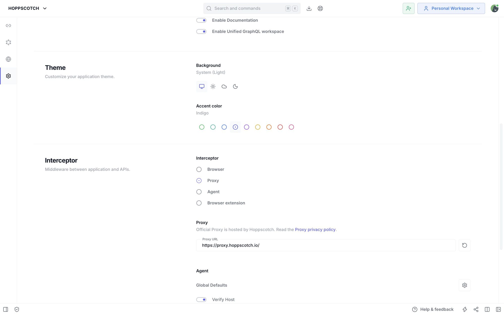

# 📨 Hoppscotch 컬렉션 — 강의 시나리오 7개

[Hoppscotch](https://hoppscotch.io) 는 **설치 없이 브라우저에서** API 요청을 보내는 무료 도구입니다.
강의에서 쓴 요청 7개를 컬렉션 파일 하나로 담았습니다: [`hackers-n8n-selfstudy.json`](hackers-n8n-selfstudy.json)

## 1. 가져오기 (Import)

1. https://hoppscotch.io 접속 → 오른쪽 위 **Login** (구글 계정 등) — 로그인하면 **Personal Workspace** 에 저장되어 어느 PC 에서나 열립니다 (안 해도 이 브라우저에는 저장됨)
2. 오른쪽 **Collections** 패널 → 위쪽 **가져오기 아이콘(📥)** → **Import from Hoppscotch**
3. `hackers-n8n-selfstudy.json` 선택 → **Import** → "7 Requests Imported" ✅

> 파일 받기: 이 저장소의 `hoppscotch/hackers-n8n-selfstudy.json` 열기 → 오른쪽 위 **Download raw file**

## 2. 내 주소로 바꾸기 — 컬렉션 변수 2개

요청 주소에 `<<n8n>>`, `<<diary_web>>` 처럼 **꺾쇠 두 개로 감싼 변수**가 들어 있습니다. 한 곳만 고치면 7개 요청에 모두 반영됩니다.

1. 컬렉션 이름 옆 **⋮** → **Properties** → **Variables** 탭
2. 값(Initial value)을 내 주소로 바꾸고 **Save**

| 변수 | 넣을 값 | 예 |
|---|---|---|
| `n8n` | 내 n8n 주소 (끝에 `/` 없이) | `https://myname.app.n8n.cloud` |
| `diary_web` | 2교시에 배포한 다이어리 주소 | `https://my-diary.vercel.app` |

## 3. 시나리오

| 폴더 | 요청 | 기대 결과 | 모드 |
|---|---|---|---|
| 1교시 · Webhook | 1-1 테스트 URL로 words 보내기 | 200 · `Workflow was started` (n8n 에서 **Listen 먼저!**) | Browser |
| | 1-2 운영 URL로 words 보내기 | 200 (워크플로우 **Publish** 상태) | Browser |
| | 1-3 GET + 쿼리로 보내보기 | **404** — POST 전용 창구 체험 | Browser |
| 2교시 · 다이어리 | 2-1 n8n 다이어리 웹훅 직접 호출 | 200 · `"저장 완료"` 답장 | Browser |
| | 2-2 안내데스크 /api/diary 호출 | 200 (Browser 는 CORS 로 막힘) | **Proxy** |
| 3교시 · RSS | 3-1 Hacker News RSS 원본 보기 | 200 · XML 원본 | **Proxy** |
| | 3-2 HN 검색 API · GET 쿼리 파라미터 | 200 · n8n 기사 5개 (JSON) | Browser |

## 4. 💡 CORS 와 Proxy

브라우저 도구로 다른 사이트를 부르면, **상대 서버가 CORS(브라우저 출입 허가)를 열어 줘야** 합니다. 안 열어 주면 `Network Error`.

**해결:** 왼쪽 **⚙️ Settings → Interceptor → Proxy** → 다시 Send

| 모드 | 누가 요청 | 언제 |
|---|---|---|
| Browser (기본) | 내 브라우저 | CORS 를 열어 둔 API (n8n 웹훅 등) |
| Proxy | Hoppscotch 서버가 대신 | CORS 없는 사이트 (RSS, 남의 API) |
| Agent / Extension | 내 PC 의 도우미 프로그램 | `localhost` · 회사 내부망 |

> ⚠️ Proxy 는 요청이 Hoppscotch 서버를 **거쳐 갑니다** → 비밀번호·API 키가 든 요청엔 쓰지 말고, 끝나면 **Browser** 로 되돌리세요.
> n8n 과 Next.js API Route 는 **서버**라서 CORS 와 무관합니다. CORS 는 **브라우저만의 규칙**입니다.
