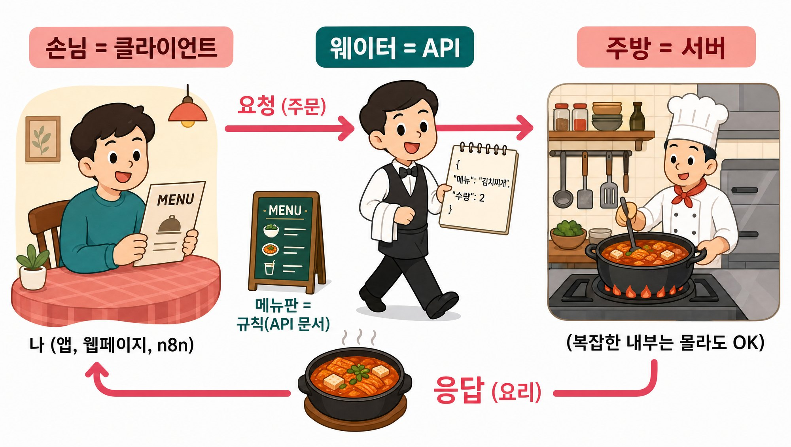
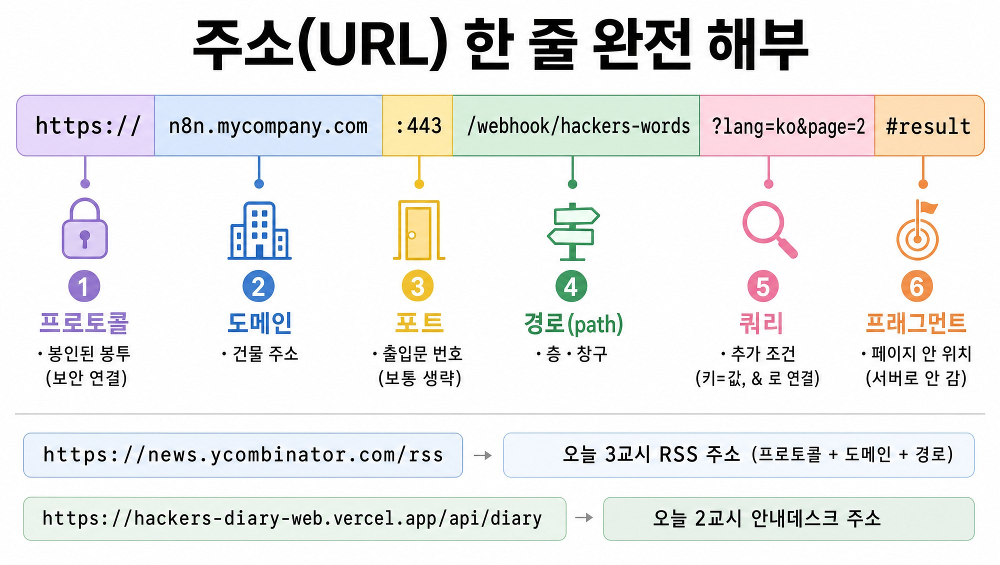
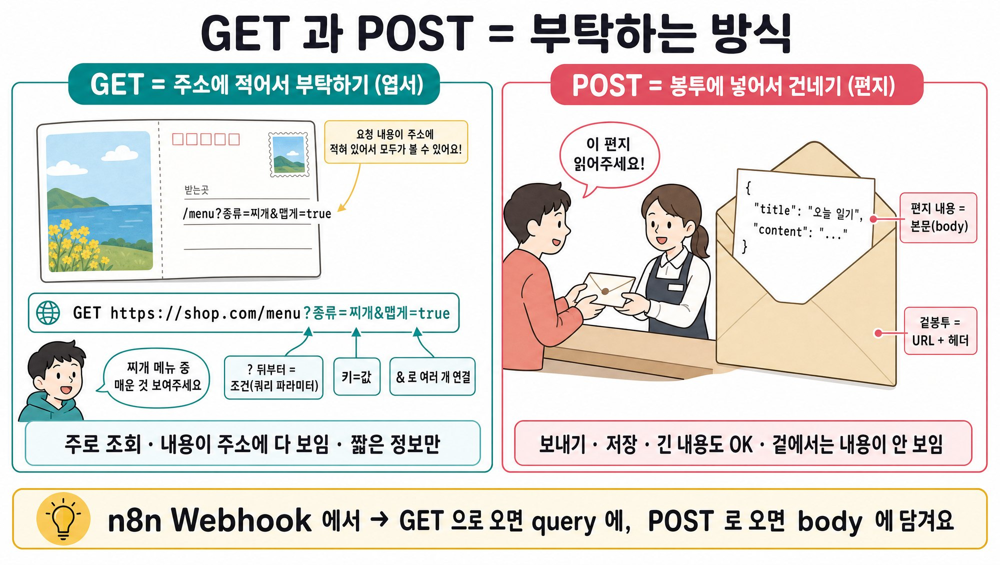
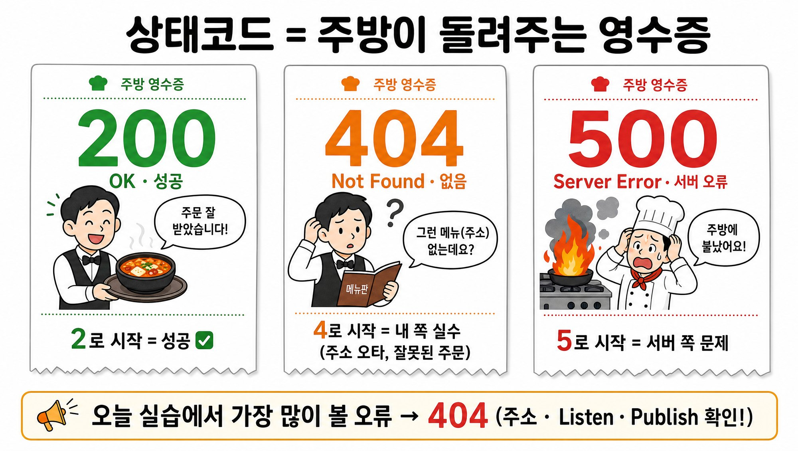
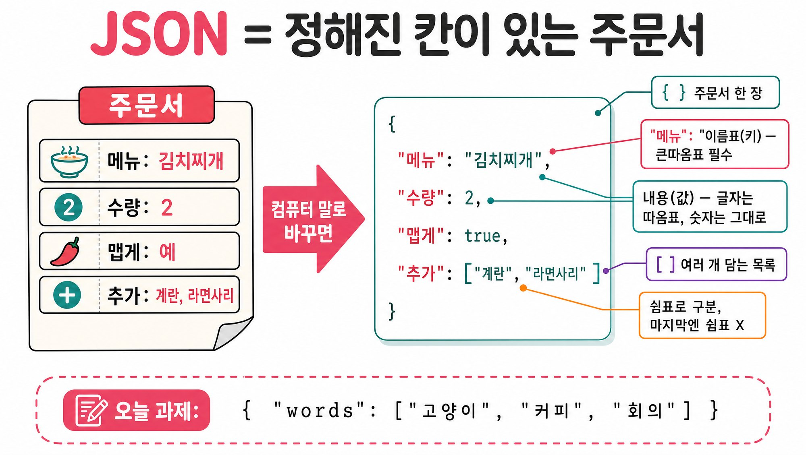
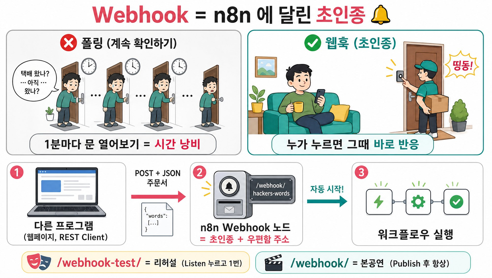
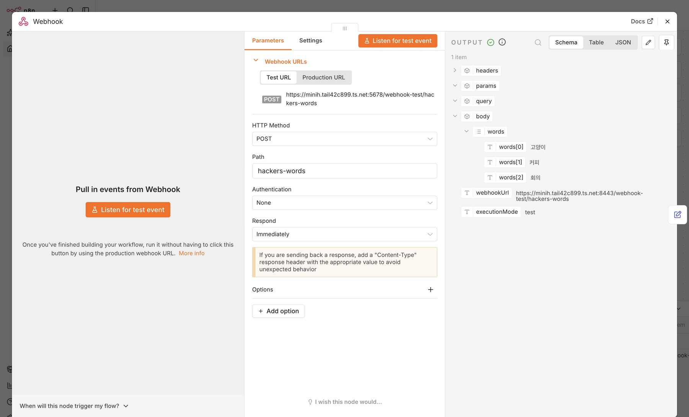
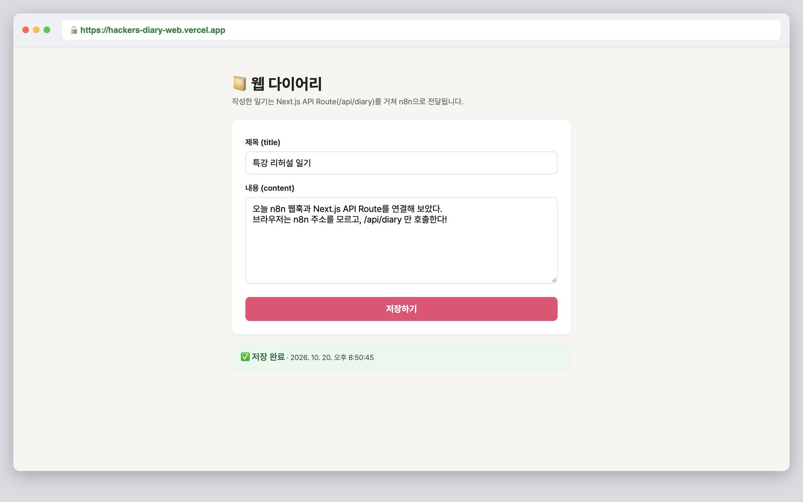
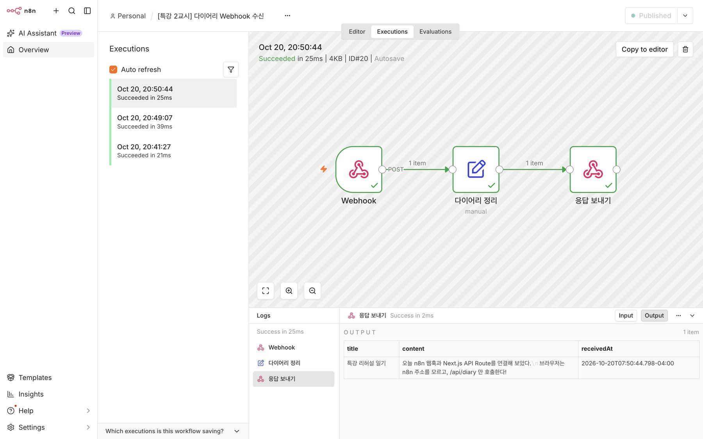
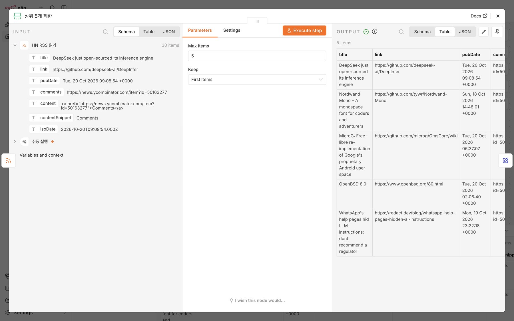

# 📘 n8n 업무자동화 셀프 실습 매뉴얼

> 강의 때 함께 만든 실습을 **혼자서 처음부터** 다시 해 보는 안내서입니다.
> 막히면 각 장 끝의 **🚧 자주 막히는 곳** 표를 먼저 보세요.

**목차**
0. 오늘 배운 개념 한 장 요약
1. 환경 준비 (n8n · Cursor · GitHub · Vercel)
2. 실습 01 — Webhook 초인종
3. 실습 02 — 웹 다이어리 → 안내데스크 → n8n
4. 실습 03 — 뉴스 5개만 골라오기
5. 보너스 04 — 매일 아침 뉴스 브리핑
6. 내 업무에 적용하기 · 다음 단계
7. 용어집

---

## 0. 오늘 배운 개념 한 장 요약

| 단어 | 비유 | 한 줄 설명 |
|---|---|---|
| **n8n** | 🏭 생산 라인 | 업무 순서도를 그려두면 그대로 반복 실행하는 자동화 도구 |
| **워크플로우** | 🍳 레시피 | 트리거(언제) → 노드(무엇을) → 연결선(순서) → 결과(어디로) |
| **API** | 🍽️ 웨이터 | 프로그램끼리 대화하는 규칙 |
| **URL** | 📮 건물 주소 + 창구 | `https://도메인/경로?쿼리` |
| **GET / POST** | 🪧 엽서 / ✉️ 편지 | GET 은 주소에 적어서, POST 는 봉투(body) 안에 넣어서 |
| **상태코드** | 🧾 영수증 | 2xx 성공 · 4xx 내 실수(404) · 5xx 서버 문제 |
| **JSON** | 📝 주문서 | `{ "이름표": 값 }` |
| **Webhook** | 🔔 초인종 | 누가 주소로 POST 하면 워크플로우 자동 시작 |
| **API Route** | 🛎️ 안내데스크 | 브라우저 대신 서버가 n8n 을 호출 (주소 숨김) |
| **환경변수** | 🔐 금고 | 비밀 주소·키는 코드 대신 금고에 |
| **배포** | 🏪 개업 | Vercel 로 내 웹을 인터넷에 공개 |
| **RSS** | 🗞️ 신문 구독 | 새 글 목록을 정해진 양식으로 받기 |
| **아이템** | 📦 벨트 위 상자 | n8n 은 데이터를 상자 단위로 하나씩 처리 |







---

## 1. 환경 준비

### 1-1. n8n — 둘 중 하나

**A. n8n Cloud (추천 · 설치 없음)**
1. https://n8n.io → **Get started for free** → 가입 (14일 무료 체험)
2. 내 n8n 주소가 생깁니다: `https://내이름.app.n8n.cloud`
3. 이 주소가 앞으로 `https://내-n8n-주소` 자리에 들어갑니다.

**B. 내 PC 에 Docker 로 설치 (무료 · 계속 사용)**
1. [Docker Desktop](https://www.docker.com/products/docker-desktop/) 설치 후 실행
2. 터미널(Windows 는 PowerShell)에서:
```bash
docker volume create n8n_data
docker run -it --rm --name n8n -p 5678:5678 -v n8n_data:/home/node/.n8n docker.n8n.io/n8nio/n8n
```
3. 브라우저에서 `http://localhost:5678` → 관리자 계정 만들기
> ⚠️ 내 PC 의 n8n 은 **인터넷에서 보이지 않아서**, 실습 02(Vercel → n8n)는 n8n Cloud 로 하는 것이 가장 쉽습니다.

### 1-2. Cursor + REST Client
1. https://cursor.com 에서 Cursor 설치 (VS Code 도 OK)
2. 왼쪽 **확장(Extensions)** → `REST Client` 검색 → 작성자 **Huachao Mao** → Install
3. `.http` 파일을 열면 요청 위에 **Send Request** 글자가 생깁니다.
> Cursor 가 없어도 OK: Mac/Linux 는 [`curl.sh`](../rest-client/curl.sh), Windows 는 [`curl.ps1`](../rest-client/curl.ps1)

### 1-3. GitHub · Vercel
1. https://github.com 가입
2. https://vercel.com → **Continue with GitHub** 로 가입

### 1-4. 워크플로우 가져오는 법 (모든 실습 공통)
1. n8n → **Create workflow** (빈 캔버스)
2. 왼쪽 위 워크플로우 이름 옆 **⋯** → **Import…** → **Import from URL…**
3. 실습별 Raw 주소 붙여넣기 → **Import**
4. 캔버스의 **노란/초록 메모**가 그 자리에서 할 일을 알려 줍니다.

---

## 2. 실습 01 — Webhook 초인종



**가져오기:** `https://raw.githubusercontent.com/joosung80/hackers-n8n-selfstudy-kit/main/workflows/01_webhook_words.json`

1. **Webhook** 노드 더블클릭 → HTTP Method **POST**, Path **hackers-words** 확인
2. **Test URL** 복사 (`…/webhook-test/hackers-words`)
3. [`rest-client/webhook.http`](../rest-client/webhook.http) 를 Cursor 로 열고 `@n8n = ` 뒤에 내 n8n 주소 입력
4. n8n 에서 **Listen for test event** 클릭 (🔔 초인종 켜기)
5. Cursor 에서 **(1) 테스트 URL** 위의 **Send Request** 클릭
6. OUTPUT → **Schema** → `body › words` 에 **고양이 · 커피 · 회의** ✅



**더 해 보기**
- `words` 에 2개만 보내 보기 → `words 검증` 노드의 `isValid` 가 **false** 로
- 오른쪽 위 **Publish** 후 **(2) 프로덕션 URL** 로 보내기 → **Executions** 탭에서 확인

### 🚧 자주 막히는 곳
| 증상 | 해결 |
|---|---|
| `404 … webhook is not registered` | **Listen for test event** 를 다시 누르고 재전송 (테스트 URL 은 1번만 받음) |
| words 가 안 보임 | `Content-Type: application/json` 줄과 JSON 사이 **빈 줄** 확인 |
| JSON 오류 | 마지막 쉼표 · 작은따옴표 → 큰따옴표 |
| Send Request 가 안 보임 | REST Client 설치 · 파일 확장자 `.http` |

---

## 3. 실습 02 — 웹 다이어리 → 안내데스크 → n8n

```
브라우저(손님) → /api/diary (Next.js 안내데스크) → n8n Webhook (직통번호)
```

**가져오기:** `https://raw.githubusercontent.com/joosung80/hackers-n8n-selfstudy-kit/main/workflows/02_diary_webhook.json`

### 3-1. n8n 쪽
1. 가져온 뒤 오른쪽 위 **Publish**
2. **Webhook** 노드 → **Production URL** 복사 (`…/webhook/hackers-diary`, `-test` 없는 것!)
3. (선택) [`rest-client/diary.http`](../rest-client/diary.http) 로 먼저 보내 보고 `저장 완료` 답장 확인

### 3-2. 웹 쪽 (코드 수정 없음)
1. https://github.com/joosung80/hackers-n8n-diary-template → **Use this template → Create a new repository**
2. https://vercel.com → **Add New… → Project** → 방금 만든 저장소 **Import**
3. **Environment Variables**: Key `N8N_WEBHOOK_URL` · Value = 3-1 에서 복사한 Production URL
4. **Deploy** → 도메인 클릭 → 제목·내용 입력 → **저장하기** → **✅ 저장 완료**
5. n8n **Executions** 탭에 내 일기 도착 확인




**코드 들여다보기** ([`diary-web/`](../diary-web/))
| 파일 | 주소 | 역할 |
|---|---|---|
| `app/page.tsx` | `/` | 🪑 홀 — 입력 폼, `fetch('/api/diary')` 만 호출 |
| `app/api/diary/route.ts` | `/api/diary` | 🛎️ 안내데스크 — 빈칸 검사 → 금고(`process.env.N8N_WEBHOOK_URL`)에서 주소 꺼내 n8n 으로 전달 |

**더 해 보기**
- n8n 의 `다이어리 정리` 뒤에 **Google Sheets → Append row** 를 붙이면 진짜 일기장이 됩니다.

### 🚧 자주 막히는 곳
| 화면 메시지 | 해결 |
|---|---|
| N8N_WEBHOOK_URL 환경변수가 없습니다 | Vercel → Settings → Environment Variables 추가 → **Deployments → ⋯ → Redeploy** |
| n8n 응답 오류 (HTTP 404) | Production URL 인지, n8n **Publish** 했는지 |
| 빌드 실패 (Vulnerable Next.js) | 직접 만든 프로젝트라면 `npm i next@15` |

---

## 4. 실습 03 — 뉴스 5개만 골라오기

**가져오기:** `https://raw.githubusercontent.com/joosung80/hackers-n8n-selfstudy-kit/main/workflows/03_hn_rss_limit.json`

1. 하단 **Execute workflow**
2. 선 위 숫자가 **1 → 30 → 5 → 5 items** 로 바뀌는지 확인
3. **상위 5개 제한** 노드 더블클릭 → 왼쪽 INPUT 30개 · 오른쪽 OUTPUT **Table** 5줄 ✅



**직접 만들어 보기 (빈 캔버스에서)**
1. `+` → **Manual Trigger**
2. `+` → **RSS Read** → URL `https://news.ycombinator.com/rss`
3. `+` → **Limit** → Max Items **5**
4. `+` → **Edit Fields (Set)** → `title` = `{{ $json.title }}`, `link` = `{{ $json.link }}`
   (왼쪽 INPUT 에서 필드를 **끌어다 놓으면** 자동으로 써집니다)

### 🚧 자주 막히는 곳
| 증상 | 해결 |
|---|---|
| Feed not found | URL 오타 · `https://` 누락 |
| Limit 뒤 1개만 | HTTP Request 로 읽으면 한 상자에 통째로 → **RSS Read** 노드 사용 |
| 5개가 안 보임 | OUTPUT **Table** 탭 · 창 넓히기 |

---

## 5. 보너스 04 — 매일 아침 뉴스 브리핑 🎁

**가져오기:** `https://raw.githubusercontent.com/joosung80/hackers-n8n-selfstudy-kit/main/workflows/04_bonus_daily_news_briefing.json`


1. **Execute workflow** → 마지막 `메시지 한 통으로 합치기` 노드에서 `message` 확인
2. 마지막 노드 뒤 `+` → 받고 싶은 곳 선택
   - **Gmail → Send a message**: 받는 사람 = 내 메일, Message = `{{ $json.message }}`
   - **Telegram → Send a text message**: 봇 만들기는 [@BotFather](https://t.me/BotFather) → 토큰을 n8n 자격증명에
   - **Slack / 카카오워크 / 팀즈** 도 같은 방식
3. 오른쪽 위 **Publish** → 내일 아침 08:00 부터 자동 도착 🎉


**내 관심사로 바꾸기** — `뉴스 RSS 읽기` URL 교체
| 관심사 | RSS 주소 |
|---|---|
| 구글 뉴스 "조선 해양" | `https://news.google.com/rss/search?q=%EC%A1%B0%EC%84%A0+%ED%95%B4%EC%96%91&hl=ko&gl=KR&ceid=KR:ko` |
| 구글 뉴스 아무 키워드 | `https://news.google.com/rss/search?q=키워드&hl=ko&gl=KR&ceid=KR:ko` (키워드는 인코딩 권장) |
| 기술 뉴스 (영문) | `https://news.ycombinator.com/rss` |

---

## 6. 내 업무에 적용하기 · 다음 단계

> **"누가 → 무엇을(JSON) → 어디로(Webhook / API)"** 로 쪼개 보면 자동화 지점이 보입니다.

| 오늘 배운 블록 | 업무 아이디어 |
|---|---|
| RSS → Limit → 메시지 | 업계 뉴스 · 정부 공고 · 경쟁사 소식 아침 브리핑 |
| + AI 노드 (OpenAI / Claude / Gemini) | 기사 3줄 요약 · "우리 과제와 관련 있나?" 판정 |
| Webhook | 사내 시스템 · 엑셀 매크로 · 구글폼이 n8n 의 초인종을 눌러 보고서 작성 |
| 웹 폼 + API Route | 장비 점검 일지 · 시험 결과 입력 → 구글시트 · 메일 알림 |

**AI 와 함께 쓰기** — Claude · ChatGPT · Cursor 에게 이렇게 부탁해 보세요:
```
n8n 워크플로우를 만들려고 해. 매일 아침 8시에 [RSS 주소]에서 최신 기사 5개를 가져와
3줄로 요약해서 Gmail 로 보내고 싶어. 필요한 노드 순서와 각 노드 설정을 알려줘.
```

**더 배우기**
- n8n 공식 문서: https://docs.n8n.io · 템플릿 갤러리: https://n8n.io/workflows
- 온라인 과정 7~18차시: n8n 설치 · SNS 자동화 · 크롤링 · AI Agent · RAG · MCP

---

## 7. 용어집

| 용어 | 뜻 |
|---|---|
| 노드 (Node) | 워크플로우의 블록 하나 |
| 트리거 (Trigger) | 워크플로우를 시작시키는 노드 (Manual · Schedule · Webhook …) |
| Execute / Executions | 실행 / 실행 기록 |
| Publish | 워크플로우 활성화 — 운영 모드 |
| Pin data | 테스트 데이터를 노드에 고정 |
| Expression `{{ }}` | 앞 노드 값을 꺼내 쓰는 빈칸 채우기 |
| `$json` | 지금 처리 중인 상자(아이템)의 내용 |
| Credential | 외부 서비스 로그인 정보(키·토큰) 보관함 |
| Header / Body | 편지 겉봉투 정보 / 편지 내용 |
| Query | URL 의 `?키=값` 추가 조건 |
