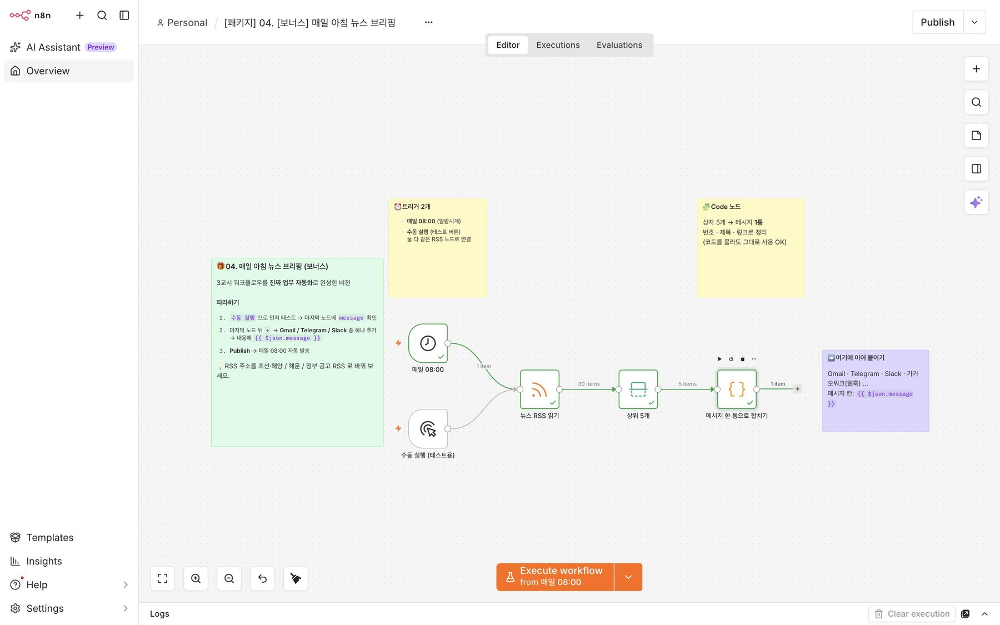
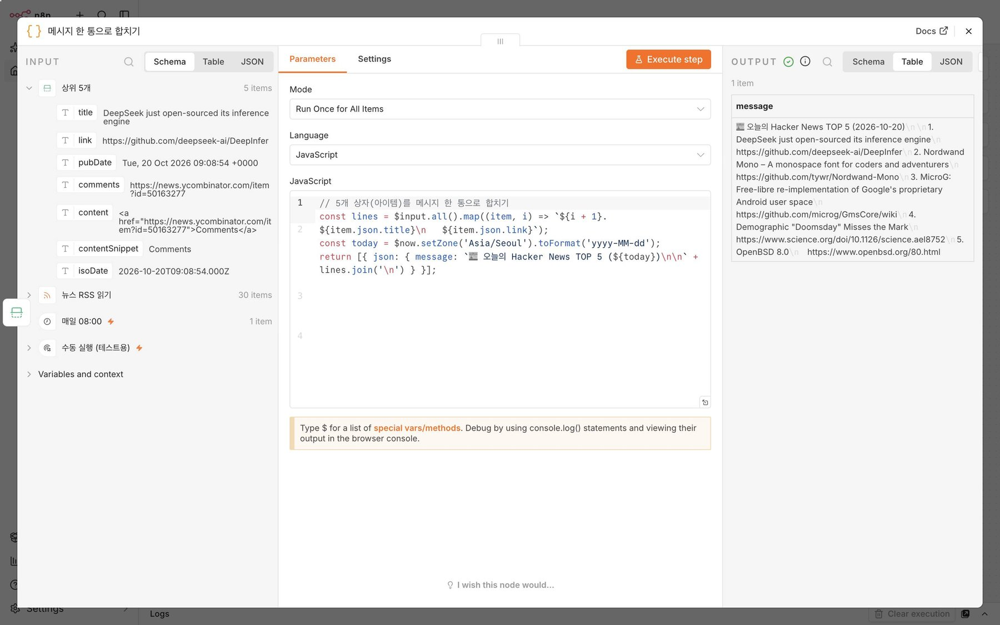

# ⚙️ 워크플로우 파일 설명

모든 파일은 **n8n 2.x** 에서 검증했고, 캔버스에 **한국어 설명 메모(스티키 노트)** 가 붙어 있습니다.
자격증명(API 키·계정)이 필요 없는 노드만 써서 **가져오자마자 실행**됩니다. (보너스의 메시지 발송 노드만 직접 추가)

## 가져오는 방법 2가지

**A. 주소로 (추천)** — n8n 새 워크플로우 → 워크플로우 이름 옆 **⋯** → **Import…** → **Import from URL…** → 아래 Raw 주소 붙여넣기
**B. 파일로** — 파일 열기 → **Download raw file** → n8n **⋯ → Import… → Import from file…**

---

## 01 · Webhook 초인종 — `01_webhook_words.json`

```
[Webhook POST /hackers-words]
```

| 노드 | 하는 일 |
|---|---|
| **Webhook** | 초인종. POST 로 온 JSON 주문서를 받아 OUTPUT 에 `body › words` 로 보여 줌 (Path `hackers-words`) |

- 보내는 쪽: [`rest-client/webhook.http`](../rest-client/webhook.http)
- Raw: `https://raw.githubusercontent.com/joosung80/hackers-n8n-selfstudy-kit/main/workflows/01_webhook_words.json`

## 02 · 웹 다이어리 수신 — `02_diary_webhook.json`

```
[Webhook POST /hackers-diary] → [다이어리 정리] → [응답 보내기]
```

| 노드 | 하는 일 |
|---|---|
| **Webhook** | 다이어리 웹의 `/api/diary` 가 보내는 글을 받음 (Respond: 응답 노드 사용) |
| **다이어리 정리** | title · content · 받은 시각 `receivedAt` 정리 |
| **응답 보내기** | 웹페이지에 `{ ok: true, message: "저장 완료" }` 답장 |

- 짝꿍 웹: [`diary-web/`](../diary-web/) 또는 템플릿 https://github.com/joosung80/hackers-n8n-diary-template
- ⚠️ **Publish(활성화)** 후 **Production URL** (`/webhook/…`) 을 Vercel 환경변수 `N8N_WEBHOOK_URL` 에
- Raw: `https://raw.githubusercontent.com/joosung80/hackers-n8n-selfstudy-kit/main/workflows/02_diary_webhook.json`

## 03 · Hacker News 5개만 — `03_hn_rss_limit.json`

```
[수동 실행] → [HN RSS 읽기 (30)] → [상위 5개 제한 (5)] → [필드 정리 title·link]
```

| 노드 | 하는 일 |
|---|---|
| **수동 실행** | 내가 누르는 시작 버튼 |
| **HN RSS 읽기** | `https://news.ycombinator.com/rss` → 기사 상자 30개 |
| **상위 5개 제한** (Limit) | 앞에서 5개만 통과 |
| **필드 정리** (Edit Fields) | `{{ $json.title }}`, `{{ $json.link }}` 만 남김 |

- Raw: `https://raw.githubusercontent.com/joosung80/hackers-n8n-selfstudy-kit/main/workflows/03_hn_rss_limit.json`

## 🎁 04 · 매일 아침 뉴스 브리핑 — `04_bonus_daily_news_briefing.json`

```
[매일 08:00] ─┐
              ├→ [뉴스 RSS 읽기] → [상위 5개] → [메시지 한 통으로 합치기] → (여기에 Gmail/Telegram/Slack)
[수동 실행] ──┘
```



| 노드 | 하는 일 |
|---|---|
| **매일 08:00** (Schedule) | 알람 시계 — Publish 하면 매일 자동 실행 |
| **수동 실행** | 테스트 버튼 |
| **메시지 한 통으로 합치기** (Code) | 5개 기사를 `📰 오늘의 Hacker News TOP 5 (날짜)` 메시지 1통으로 |

**완성하기:** 마지막 노드 뒤 `+` → Gmail / Telegram / Slack 중 하나 → 본문에 `{{ $json.message }}` → Publish
**내 업무로 바꾸기:** `뉴스 RSS 읽기` 의 URL 을 관심 분야 RSS 로 교체 (예: 구글 뉴스 검색 RSS `https://news.google.com/rss/search?q=%EC%A1%B0%EC%84%A0+%ED%95%B4%EC%96%91&hl=ko&gl=KR&ceid=KR:ko`)



- Raw: `https://raw.githubusercontent.com/joosung80/hackers-n8n-selfstudy-kit/main/workflows/04_bonus_daily_news_briefing.json`
